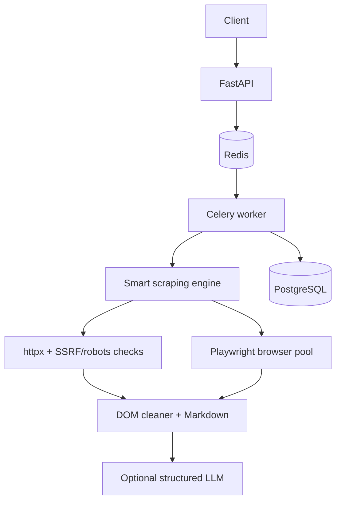

# CrawlForge

[](https://github.com/HoosseinRahimi/crawlforge/actions/workflows/ci.yml)

CrawlForge is a responsible, AI-assisted distributed web extraction platform built as a portfolio-quality FastAPI service. It tries lightweight HTTP first, falls back to an isolated reusable Playwright browser when a page is JavaScript-dependent, cleans the DOM, emits Markdown, and can validate structured extraction through an LLM provider.

## Features

- Synchronous scraping and extraction plus Redis/Celery asynchronous jobs
- Breadth-first crawling with normalization, limits, pacing, canonical handling, and robots.txt enforcement
- SSRF defenses for private, loopback, link-local, metadata, reserved, and rebinding-prone targets
- Isolated reusable Chromium contexts, configurable proxies, retries, retention limits, and structured errors
- API-key hashing, per-key Redis rate limits and monthly quotas
- PostgreSQL persistence, Prometheus metrics, JSON logs, optional OpenTelemetry/Grafana stack

## Architecture



## Quick start

```powershell
Copy-Item .env.example .env
# Replace API_KEY_PEPPER with a random secret.
docker compose up --build
docker compose run --rm api crawlforge api-key create --name local
```

The command prints a bearer key once. Keep it in a local shell variable and never commit it. API docs are at <http://localhost:8000/docs>, metrics at <http://localhost:8000/metrics>, and readiness at <http://localhost:8000/ready>.

## API examples

```bash
export CRAWLFORGE_API_KEY='crawl_...'
curl -H "Authorization: Bearer $CRAWLFORGE_API_KEY" \
  -H 'content-type: application/json' \
  -d '{"url":"https://example.com","render_js":"auto","output":["markdown"]}' \
  http://localhost:8000/v1/scrape

curl -H "Authorization: Bearer $CRAWLFORGE_API_KEY" \
  -H 'content-type: application/json' \
  -d '{"url":"https://example.com","max_depth":1,"max_pages":10}' \
  http://localhost:8000/v1/crawl
```

`/v1/jobs` and `/v1/crawl` return a job ID. Poll `/v1/jobs/{id}` and retrieve pages from `/v1/jobs/{id}/results?limit=50`. `/v1/extract` accepts either the compact `{field: type}` format or JSON Schema. Set `OPENAI_API_KEY` to enable it; otherwise it returns `LLM_DISABLED` without making an external call.

## Configuration and operations

All settings are documented in `.env.example`. The base Compose stack needs roughly 2–4 GiB RAM; Playwright plus the optional observability profile is more comfortable with 4–6 GiB. Add `--profile observability` to start Prometheus and Grafana. Use `make test`, `make lint`, `make typecheck`, `make up`, and `make down` (or the equivalent `uv run`/PowerShell commands on Windows).

## Security model

Only HTTP(S) is accepted. URLs with credentials, private/loopback/link-local/metadata/reserved addresses, unsafe DNS answers, unsafe redirects, and disallowed robots paths are rejected. Browser requests are intercepted as well. The application re-resolves hosts and validates peer addresses, but network-layer egress controls are still recommended for production. CrawlForge does not bypass CAPTCHAs, authentication, paywalls, or anti-bot controls.

## Testing and load testing

Unit tests use deterministic fixtures and do not depend on public sites. Integration tests require PostgreSQL, Redis, Celery, and a local fixture server. Run `uv sync --extra dev && uv run pytest -q`. Run k6 after the stack is up:

```bash
docker run --rm --network host -e BASE_URL=http://localhost:8000 -e CRAWLFORGE_API_KEY="$CRAWLFORGE_API_KEY" -v "$PWD/load-tests:/scripts" grafana/k6 run /scripts/scrape.js
```

Benchmark numbers are intentionally omitted until a real run is recorded.

## Project structure

`app/api` contains HTTP contracts, `app/scraper` the fetch/browser pipeline, `app/crawler` BFS traversal, `app/extractor` cleaning/Markdown, `app/llm` provider adapters, `app/workers` Celery tasks, `app/db` persistence, `app/security` URL checks, and `app/observability` metrics/logging.

## Known limitations and roadmap

Application-layer DNS checks cannot replace a production egress firewall. Binary document extraction, authenticated sessions, JavaScript action scripting, and durable object storage are not included in v1. Future work includes a dedicated egress proxy, richer crawl scheduling, object-store bodies, per-tenant dashboards, and additional LLM adapters.

## GitHub metadata

Suggested description: **Responsible AI-powered distributed web extraction with FastAPI, Celery, Playwright, SSRF protection, and structured outputs.**

Suggested topics: `web-scraping`, `crawler`, `fastapi`, `celery`, `playwright`, `distributed-systems`, `postgresql`, `redis`, `prometheus`, `ai-extraction`.
